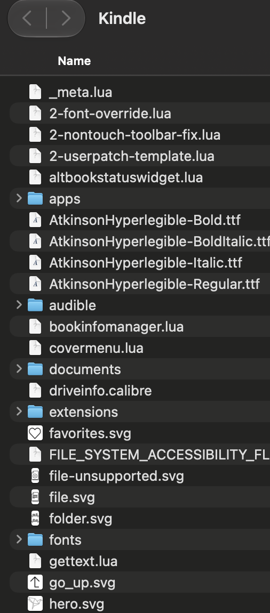
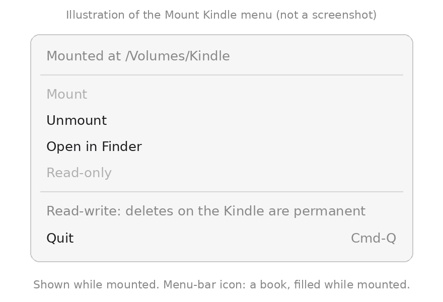

# kindle-mtp-mount

[](https://github.com/voantony/kindle-mtp-mount/releases/latest)
[](LICENSE)

Mount a Kindle (MTP) on macOS as a read-write removable drive in Finder: a menu-bar app (`.dmg`) and a CLI.

Shows a Kindle that's plugged into a Mac by USB as a removable drive called
**Kindle** in Finder, listed under **Locations** with an eject button, like a
USB stick. You can browse it, copy books off it, and drag files onto it.

<p align="center"></p>
<p align="center"><sub>A Kindle Colorsoft open in Finder.</sub></p>

## Install

- **App (easiest):** download **[Mount-Kindle-0.1.1.dmg](https://github.com/voantony/kindle-mtp-mount/releases/download/v0.1.1/Mount-Kindle-0.1.1.dmg)**
  from the [latest release](https://github.com/voantony/kindle-mtp-mount/releases/latest),
  drag **Mount Kindle** to Applications, and open it (right-click → **Open**
  the first time; see [First launch](#mac-app)). You also need
  [macFUSE](https://macfuse.github.io/) 5.x with its file system extension
  turned on; see [Setup](#setup).
- **With your AI agent:** give it this repo's link
  (`https://github.com/voantony/kindle-mtp-mount`). [AGENTS.md](AGENTS.md)
  tells it what to run and which steps you have to do yourself, and
  [install.sh](install.sh) does the rest.
- **Manually (command line):** install [macFUSE](https://macfuse.github.io/)
  5.x and [Homebrew](https://brew.sh), then run `./install.sh` in a copy of
  this repo. After that, complete the one-time step in [Setup](#setup).

Newer Kindles (for example the Kindle Colorsoft) connect over MTP, the same
phone-style protocol Android uses. macOS doesn't show MTP devices in Finder.
This small program bridges the gap. It talks MTP with
[libmtp](https://github.com/libmtp/libmtp) and presents the files to macOS
through [macFUSE](https://macfuse.github.io/).

**Read-write by default.** Copying, renaming, creating folders and deleting
all work. Use `kindle-mount --ro` or the app's **Read-only** switch to only
browse.
**Deletes are immediate and permanent.** There's no Trash on the Kindle, so
anything you delete there is gone.

Tested on 30 October 2026 with a Kindle Colorsoft (1st gen, USB ID `1949:9981`),
macOS 27.2, macFUSE 5.5 (FSKit backend) and libmtp 1.1.23:

- Read-only mount (`--ro`): browsing the root and about 890 entries in
  `documents`, reading files with `cat` and `cp`, and copying books off (a
  7.3 MB book matched `kpush pull` byte for byte by MD5). `touch` and `mkdir`
  were refused with "Read-only file system".
- Read-write mount, in a scratch folder only: creating a folder, writing a file
  and reading it back, overwriting it, renaming it, creating a subfolder and a
  file inside it, deleting the files and both folders. `.DS_Store` never
  reached the Kindle.
- The drive showed up at `/Volumes/Kindle`. After unmounting, the Kindle was
  free for other MTP tools right away, with no replug.
- 31 October 2026, version 0.1.1: mounted as a local volume, macOS reports it
  as local, removable and ejectable (like a mounted disk image), so Finder
  lists it under Locations. Ejecting it the way Finder does unmounted it and
  released the Kindle. Read-write still worked in a scratch folder, and an
  idle read-write mount wrote nothing to the Kindle.

## Requirements

- macOS 15.4 or later, on Apple silicon
- [macFUSE](https://macfuse.github.io/) 5.x, with its file system extension
  turned on (see Setup)
- libmtp 1.1.23 from Homebrew: `brew install libmtp` (not needed for the app,
  which bundles it)

## Setup

After installing macFUSE, turn on its file system extension once:

**System Settings → General → Login Items & Extensions → File System
Extensions → macFUSE** (switch it on).

Until you do, mounting fails with "File system extension not enabled".

**Don't enable kernel extensions in Recovery Mode.** That step is only needed
for macFUSE's older kernel-extension backend. This tool uses the FSKit
backend, which needs no kernel extension and no security changes to your Mac.

## Build and install

```sh
./install.sh    # checks requirements, builds, tests, installs to ~/.local/bin
                # (safe to re-run; ./install.sh --prefix DIR for another folder)

# or by hand:
make            # builds ./kindle-mtpfs
make test       # optional: unit tests against a fake in-memory device
make install    # copies kindle-mtpfs, kindle-mount, kindle-unmount to ~/.local/bin
                # (change with: make install PREFIX=/some/dir)
```

## Use

1. **Quit Calibre first** (and Android File Transfer, OpenMTP, or anything else
   that talks to the Kindle). Only one program can hold the Kindle at a time.
2. Plug in the Kindle and unlock it.
3. Run:

```sh
kindle-mount           # read-write
kindle-mount --ro      # read-only: every change is refused
kindle-unmount         # unmount and give the Kindle back to Calibre etc.
```

The drive appears at `/Volumes/Kindle` and in Finder's sidebar under
**Locations** with an eject button, like a USB stick. Ejecting it there
unmounts it and releases the Kindle. It's mounted as a "local" macFUSE volume
for this; macFUSE calls that option experimental, so `kindle-mount --no-local`
mounts it the old way (reachable at `/Volumes/Kindle`, but not listed in
Locations). Spotlight doesn't index it, and macOS's `.Trashes`, `.fseventsd`
and `._*` files are refused, so nothing extra gets written to the Kindle. Logs go to `~/Library/Logs/kindle-mount.log`.

If the Kindle is busy, `kindle-mount` says so and stops. It never retries in a
loop and never resets the USB connection.

## Mac app

`Mount Kindle.app` puts a book icon in the menu bar with **Mount**,
**Unmount**, **Open in Finder**, a **Read-only** switch and **Quit**.

<p align="center"></p>
<p align="center"><sub>Illustration of the menu while mounted, drawn from the app's menu items (not a screenshot).</sub></p>

Download it from the [latest release](https://github.com/voantony/kindle-mtp-mount/releases/latest)
(`.dmg` or `.zip`), or build it yourself (below). It runs
the same `kindle-mtpfs` helper, bundled inside the app together with libmtp
and libusb, so Homebrew isn't needed on a Mac that only runs the app. macFUSE
still has to be installed and its file system extension turned on (see Setup).

If something is in the way, the menu says so and tells you what to do:
macFUSE missing, file system extension off (with the exact System Settings
path), Calibre running, no Kindle plugged in, or the Kindle busy in another
app. Quitting the app unmounts the Kindle first. Its log is at
`~/Library/Logs/MountKindle.log`, with the serial masked.

Scripts and AI agents can drive it with `open mountkindle://mount`,
`open mountkindle://unmount` and `open mountkindle://quit`.

Build it:

```sh
app/build-app.sh     # writes dist/Mount Kindle.app, dist/Mount-Kindle-<version>.zip and .dmg
```

**First launch (Gatekeeper).** The app is signed ad hoc, not by an Apple
Developer ID, so if you downloaded it macOS will block it the first time.
Either right-click the app and choose **Open**, then confirm, or go to
**System Settings > Privacy & Security** and click **Open Anyway** after the
first try. You only have to do this once. An app you built yourself isn't
quarantined, so it opens normally. Third-party license texts are inside the
app in `Contents/Resources/Licenses`.

## How it works

- Folder listings are read lazily and cached for 5 seconds.
- Small files are downloaded to a temp file the first time they're read. For
  big files (over 2 MB), the first couple of reads use MTP partial reads, so
  Finder previews don't pull the whole book. A full download happens only if a
  program keeps reading.
- New and changed files are uploaded when the file is closed, and the size on
  the Kindle is checked against the local copy. Replacing an existing file
  uploads `name.kmtmp` first, checks it, then deletes the old file and renames
  the new one into place, so a failed upload never loses the old copy.
- macOS clutter (`.DS_Store`, `._*` AppleDouble files, `.Trashes`,
  `.fseventsd`, `.Spotlight-V100`, …) is kept in memory only and never written
  to the Kindle. Extended attributes are accepted and dropped.
- The Kindle serial number is masked in everything the tool prints.
- On unmount, the Kindle is released without a USB reset.

## Limitations

- Only the Kindle Colorsoft (1st gen) USB ID is accepted. The code also relies
  on libmtp 1.1.23 internals to stop libmtp resetting USB on close, and checks
  that version at startup.
- Moving a file between folders uses MTP MoveObject. If the Kindle refuses
  that, the move fails with "cross-device link". Copy and delete instead.
- Timestamps and permissions can't be changed (MTP doesn't store them). Such
  requests succeed but do nothing.
- Files written from the Mac are held in a temp file until closed, so a very
  large copy needs that much free space on the Mac.
- Names typed in Finder with accents are stored in macOS's decomposed Unicode
  form.
- One request at a time. MTP is slow, so big copies take a while.

## Support

If this saves you time and you'd like to say thanks, tips are welcome. Always optional.

**Venmo:** [@Antony-Vo](https://venmo.com/u/Antony-Vo) (US)

**Crypto:**

| Coin | Address |
| --- | --- |
| Bitcoin (BTC) | `bc1pug8q2ceda7f3p30ezptg2mnz4khg9d5v9fd6p454qqs20zdyzw8qnuf8cx` |
| Ethereum (ETH, and tokens on EVM chains) | `0xf9439c4330427E45017A3c4454137474DEbB3E36` |
| Monero (XMR) | `84iCefzmu82Ha9eHPyRpsKPLcuEkBxBRxZm1FSx72T5S1CULgQkabtf9K8Lwxf6NFaLvUoJPqAqvL1EgaSvR7rMbJhKupfr` |

Please double-check the address before you send. Crypto transfers can't be reversed.

## License

MIT. See [LICENSE](LICENSE). This project links dynamically against libmtp
(LGPL-2.1) and macFUSE's libfuse. No code from other MTP filesystems was used.
